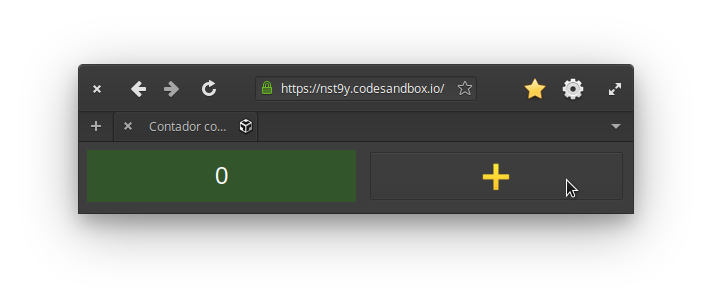

#+PROPERTY: header-args:js  :exports code
#+EXPORT_FILE_NAME: ../latex/capitulos/cases

# header-args is needed to use src_js{} for inline source code

* Delineamento
** As interfaces e as exigências de coordenação
  @@latex:\todo{Trecho vindo da introdução no corte de outubro de 2026, ainda por integrar a esta seção.}@@

  O conjunto de interfaces é um /benchmark/ de notação, como os /benchmarks/
  de resultado qualitativo do projeto de linguagens
  [[cite:erdweg2015][p. 35]], entre os quais está o 7GUIs
  [[cite:lu2021][8:20]].

  - Formulário com validação: :: os campos que dependem uns dos outros, o
    estado derivado e o envio que, enquanto espera a resposta, ignora um
    novo clique em Reservar, para o usuário não reservar o mesmo voo duas
    vezes;
  - Busca com sugestões: :: o cancelamento da busca já requisitada, a resposta
    anterior que nunca aparece e a lista derivada das sugestões, para o
    usuário ver só as cidades correspondentes ao texto que está no campo;
  - Login com quarentena: :: a tentativa nova que cancela a anterior, para
    o usuário que errou a senha tentar de novo sem esperar a resposta da
    primeira, e o relógio da sessão, que para quando a sessão se encerra;
  - Quadro de tarefas: :: o estado compartilhado entre o cabeçalho e três
    colunas, o limite de duas tarefas em "Fazendo", que desabilita os
    botões das outras colunas, e o quadro gravado no navegador, para o
    usuário achar cada tarefa na coluna em que a deixou, ao voltar à página
    ou em outra aba;
  - Dados ao vivo: :: valores que uma fonte envia sem o usuário pedir, como
    o placar de um jogo, a inscrição presa à tela e a pausa, para quem
    acompanha o painel ler os valores sem que a tabela se atualize.

  A orquestração pesa mais na Busca, no Login e nos Dados ao vivo, e o
  gerenciamento de estado, no Formulário e no Quadro.
  O Formulário adapta o /Flight Booker/, uma das sete interfaces do 7GUIs, de
  [[textcite:kiss2014][p. 11 e 25]], e acrescenta os campos de nome e de
  e-mail.
  O Login segue o painel de [[textcite:berry2020][p. 534]], e os Dados ao
  vivo adaptam a placares de jogos as cotações que uma fonte manda aos
  clientes, de [[textcite:meijer2012][p. 66]].

** As tecnologias e os pares
  @@latex:\todo{Trecho vindo da introdução no corte de outubro de 2026, ainda por integrar a esta seção.}@@

  Na web, Web Component, React e Solid, uma tecnologia por modelo de
  programação, implementam as cinco interfaces.
  O imperativo por atualização manual entra com o Web Component, a forma do
  próprio navegador de criar elementos personalizados cite:mozilla2026.
  Lit e Angular com /signals/ implementam três interfaces cada, em pares de
  tecnologias próximas: o Lit com o Web Component, e o Angular com o Solid.
  O Lit se constrói sobre o Web Component: seus componentes são elementos
  personalizados do navegador, mas cada alteração de estado chama de novo o
  método que monta a tela cite:google2026d.
  Por isso fica no declarativo por re-renderização, como o React, com
  outra notação.
  O par Web Component e Lit, no Formulário, na Busca e nos Dados ao vivo,
  mantém o modelo de componente e a orquestração.
  Muda só a ligação do estado com a tela, escrita à mão no primeiro e
  refeita pelo /template/ a cada alteração de estado no segundo.

  No React e no Solid, a tela se monta em JSX, marcação parecida com [[gls:html]]
  escrita dentro do JavaScript cite:meta2026c.
  O que os separa, sobretudo, é o modo de coordenar: a cada alteração de
  estado, o React reexecuta o componente inteiro, e o Solid atualiza só os
  trechos da tela que dependem do /signal/ alterado
  [[cites:&lee2025 289:38;&solidjs2026]].

  Solid e Angular com /signals/, ao contrário, coordenam do mesmo modo: os
  dois guardam o estado em /signals/ e derivam valores de outros /signals/
  cite:solidjs2026a,google2026.
  Por isso ficam no mesmo modelo de programação, e o par, no Formulário,
  na Busca e no Quadro, mostra como a notação varia entre tecnologias em
  três pontos.
  No Solid, a tela se monta em JSX numa função, e, no Angular, num /template/
  baseado em [[gls:html]], com construtos próprios cite:google2026a.
  O componente do Angular é uma classe com decorador cite:google2026b, e
  participa da injeção de dependências cite:google2026c.
  E as [[glspl:api]] dos dois diferem no que vai além do /signal/ e do valor
  derivado, como o cancelamento das requisições na Busca.
  Quando o /signal/ se altera, o Solid recalcula só os valores e trechos da
  tela que dependem dele cite:solidjs2026; o Angular marca o componente que o
  lê e o atualiza na próxima detecção de alterações cite:google2026.

  Dentro de um mesmo modelo de programação, a notação também muda de uma
  tecnologia para outra, como entre o Solid e o Angular com /signals/ ou
  entre o React e o Lit, e a avaliação registra quando essa diferença muda
  a posição.

  Fora da web, cada plataforma tem um par de tecnologias, que confere se
  as posições encontradas na web se repetem em outra plataforma e outra
  linguagem.
  No Android, Views e Compose implementam o Formulário, o Quadro e os
  Dados ao vivo.
  As Views ficam no imperativo por atualização manual, e o Compose, no declarativo
  por re-renderização, porque chama de novo as funções da tela quando o estado
  se altera cite:android2026.
  No /desktop/, Windows Forms e WPF implementam o Formulário, o Quadro e o
  Login.
  O Windows Forms fica no imperativo por atualização manual, porque o
  tratador de cada evento atribui os valores aos controles, sem o /data
  binding/ que ele também oferece [[cites:&microsoft2025b;&microsoft2026a]],
  e o WPF, no declarativo por atualização granular, porque, quando um dado se altera, os elementos ligados a
  ele se atualizam sozinhos cite:microsoft2025.

  Na web, só o par Web Component e Lit isola o imperativo por
  atualização manual, e só em três interfaces.
  Ele isola a ligação do estado com a tela, e não a orquestração, que no
  Lit se escreve como no Web Component.
  Fora da web, os dois pares mudam também a montagem da tela, e cada
  plataforma confere só dois dos três modelos de programação: o Android
  fica sem o declarativo por atualização granular, e o /desktop/, sem o
  declarativo por re-renderização.

  @@latex:\todo{Trecho vindo da introdução no corte de outubro de 2026, ainda por integrar a esta seção.}@@

  O nome do modelo diz como a alteração do estado chega à tela, e não como
  a tela se monta.
  Nas implementações deste trabalho, o esqueleto da tela do Web Component
  fica em [[gls:html]], e só se montam elemento a elemento as partes que o
  estado repete ou põe e tira da tela, como os itens de uma lista.
  Os textos e os valores calculados do estado mudam nos elementos já
  montados, e essa atualização é a parte imperativa.

  O Web Component com /signals/ é uma construção de controle, feita para
  este trabalho, e não tirada de programas reais.
  Nele, o =solid-js= serve só como biblioteca de /signals/, e a classe e a
  montagem da tela são as do Web Component.
  O Web Component e o React não formam par: a parte da diferença entre
  eles que vem só da re-renderização se lê no par Web Component × Lit, e
  o resto se atribui ao passo da cadeia em que ela aparece.
  A que nenhum passo explica se atribui pelo sinal escrito na notação: se
  ele está na coordenação, na montagem da tela ou na ligação entre as duas.

  Os pares isolam pouco: o primeiro passo da cadeia muda, além do modelo
  de programação, a orquestração, que segue a do Solid.
  Atribuir aos passos da cadeia a diferença entre o Web Component e o
  React supõe que os passos se somam.
  O par Web Component × Lit também muda, com a ligação, a montagem das
  partes repetidas, que a re-renderização refaz a cada alteração.
  A suposição falha quando um passo muda a leitura de outro, como a
  montagem em JSX pode mudar a leitura do modo como o estado chega à tela.

** As rodadas
  @@latex:\todo{Trecho vindo da introdução no corte de outubro de 2026, ainda por integrar a esta seção.}@@

  A avaliação se faz em três rodadas, cada uma mais estreita que a
  anterior, como as de [[textcite:kiss2014][p. 3]]: a primeira responde à
  P1, e a segunda e a terceira, à P1.1 e à P1.2.
  Na primeira rodada, as tecnologias implementam as interfaces descritas acima.
  Na segunda, cada interface recebe funcionalidades, como o assistente
  em três passos do Formulário, e requisitos de orquestração, como a
  espera de 300 ms depois da última tecla na Busca.
  Uma funcionalidade muda o que o usuário percebe ou pode fazer, e um
  requisito de orquestração deixa a tela igual e muda só como se combinam
  os eventos.
  São onze mudanças, feitas uma por /commit/ e na mesma ordem em
  todas as tecnologias que implementam a interface.
  A segunda rodada faz o código crescer porque é nos problemas grandes que os efeitos
  da viscosidade mais aparecem [[cite:green1996d][p. 161]].
  Na terceira, o Formulário estendido é reescrito em cada tecnologia
  com a biblioteca de formulário mais usada no ecossistema dela, ou com a
  [[gls:api]] da plataforma quando nenhuma predomina.
  Como as bibliotecas variam de uma tecnologia para outra, a conclusão da
  terceira rodada vale para o ecossistema típico de cada tecnologia, e não só
  para o modelo de programação.

  #+CAPTION: As sete interfaces rodada a rodada: a primeira constrói as 35 implementações; a segunda acrescenta de uma a três mudanças por interface, 13 ao todo; a terceira refatora o código da segunda em seis pares interface-vertente, mais um opcional. Cada marca vale para as cinco tecnologias. Grafite: imperativo por atualização manual; ocre: declarativo por atualização granular; roxo: declarativo por re-renderização.
  #+NAME: fig:interfaces-por-rodada
  #+ATTR_LATEX: :options [htbp]
  #+begin_figure
  #+begin_export latex
  \centering
  \begin{tikzpicture}[delineamento,
      grade/.style={matrix of nodes, nodes in empty cells, row sep=0pt, column sep=0pt,
        inner sep=0pt, outer sep=0pt,
        nodes={anchor=center, inner sep=0.05cm, minimum height=0.55cm,
          text width=1.9cm, align=center,
          execute at begin node={\hyphenpenalty=10000 }},
        column 1/.style={nodes={text width=3.3cm, align=left}},
        column 3/.style={nodes={text width=2.1cm}},
        row 1/.style={nodes={minimum height=0.85cm, font=\scriptsize}},
        row 9/.style={nodes={minimum height=0.85cm, font=\scriptsize}}},
      % A marca é um círculo na cor do texto, e não um quadrado cinza, para
      % não se confundir com a caixa de um modelo de programação.
      marca/.style={circle, fill=black, minimum size=5.5pt, inner sep=0pt},
      opcional/.style={circle, draw=black, dash pattern=on 1pt off 0.8pt, line width=0.6pt,
        minimum size=5.5pt, inner sep=0pt},
      regua/.style={draw=black!15},
      divisa/.style={draw=black!40},
      rodada/.style={anchor=south, inner sep=2pt, align=center},
    ]
    \matrix[cadeia] (t) {
      |[rer]| \tecnologia{Lit}{\rerender} &
      |[imp]| \tecnologia{Web Component}{\imperativo} &
      |[gra]| \tecnologia{Web Component com \emph{signals}}{\granular} &
      |[gra]| \tecnologia{Solid}{\granular} &
      |[rer]| \tecnologia{React}{\rerender} \\
    };
    \node[font=\scriptsize, above=4pt of t.north west, anchor=south west, inner sep=0pt]
      {Cada marca e cada número valem para as cinco tecnologias:};
    \matrix[grade, below=1.25cm of t] (m) {
      & implementa & mudanças & ecossistema & máquina de estados & API nova da plataforma & padrões de projeto \\
      Contador & & 1 & & & & \\
      Reserva de passagem & & 1 & & & & \\
      Busca com sugestões & & 2 & & & & \\
      Login com quarentena & & 2 & & & & \\
      Placar ao vivo & & 3 & & & & \\
      Planilha & & 1 & & & & \\
      Circle Drawer & & 3 & & & & \\
      ao todo & 35\par implementações & 13 mudanças\par 65 \emph{commits} & & & & \\
    };
    % Os títulos das rodadas sobre as colunas de cada uma.
    \path (m-1-2.north west) -- (m-1-2.north east)
      node[midway, rodada] {\textbf{1.ª rodada}\\\scriptsize P1};
    \path (m-1-3.north west) -- (m-1-3.north east)
      node[midway, rodada] {\textbf{2.ª rodada}\\\scriptsize P1.1};
    \path (m-1-4.north west) -- (m-1-7.north east)
      node[midway, rodada] {\textbf{3.ª rodada}: as vertentes\\\scriptsize P1.2};
    \path (m-9-4.west) -- (m-9-7.east)
      node[midway, font=\scriptsize, align=center] {6 pares e 30 refatorações, mais 1 par opcional};
    % Réguas: forte sob os títulos e sobre o total, leve entre as interfaces.
    \draw[black!60] (m-1-1.south west) -- (m-1-7.south east);
    \foreach \r in {2,...,7} \draw[regua] (m-\r-1.south west) -- (m-\r-7.south east);
    \draw[black!60] (m-8-1.south west) -- (m-8-7.south east);
    \foreach \c in {2,3,4} \draw[divisa] (m-1-\c.north west) -- (m-9-\c.south west);
    % As marcas: a primeira rodada em todas as interfaces; a terceira nos pares.
    \foreach \r in {2,...,8} \node[marca] at (m-\r-2) {};
    \foreach \r/\c in {3/4, 6/4, 6/5, 6/6, 8/6, 8/7} \node[marca] at (m-\r-\c) {};
    \node[opcional] at (m-8-5) {};
    % Legenda das marcas.
    \node[marca, below=0.35cm of m.south west, anchor=north west, xshift=0.1cm] (l1) {};
    \node[right=3pt of l1, font=\scriptsize, inner sep=0pt] (l1t) {a interface entra na rodada ou no par};
    \node[opcional, right=0.6cm of l1t] (l2) {};
    \node[right=3pt of l2, font=\scriptsize, inner sep=0pt] {par opcional, o primeiro a sair no corte};
  \end{tikzpicture}
  #+end_export
  #+end_figure

  @@latex:\todo{Trecho vindo da introdução no corte de outubro de 2026, ainda por integrar a esta seção.}@@

  Cada vertente entra na interface cuja exigência de coordenação ela sabe
  tratar.
  A biblioteca que o ecossistema de cada tecnologia usa vai à Reserva de
  passagem e ao Placar ao vivo; a máquina de estados tipada, ao Placar ao
  vivo; a [[gls:api]] nova da plataforma, ao Placar ao vivo e ao Circle
  Drawer; e o padrão de projeto, ao Circle Drawer.

  Na vertente do ecossistema, a forma de cada tecnologia é a biblioteca
  com mais da metade dos downloads no npm entre as que guardam o estado
  do formulário ou tratam a conexão ao vivo
  (Tabela [[ref:tab:bibliotecas-do-ecossistema]]).
  Antes da conta saem as depreciadas, as arquivadas e as sem versão há
  mais de 24 meses.
  Quando nenhuma domina, a forma é a [[gls:api]] da plataforma.
  No Web Component com /signals/ e no Lit, vale a forma do Web Component,
  para o passo a cada um não mudar também a biblioteca.
  Pelo mesmo motivo, o React usa na Reserva de passagem a biblioteca do
  Solid, que tem adaptador oficial nas duas tecnologias.
  Nas duas primeiras rodadas, o Placar ao vivo recebe os lotes por
  [[gls:sse]], e o navegador refaz sozinho a conexão que cai
  [[cite:whatwg2026][§ 9.2.1]].
  A frequência escolhida pelo usuário, na segunda, vai ao servidor por
  uma requisição à parte, a solução provisória que o jargão chama de
  gambiarra.
  A vertente do ecossistema a substitui pelo WebSocket, e a reconexão
  passa à biblioteca.

  #+CAPTION: Bibliotecas da vertente do ecossistema, por interface e tecnologia.
  #+NAME: tab:bibliotecas-do-ecossistema
  #+ATTR_LATEX: :options [htbp]
  #+begin_table
  #+LATEX: \centering
  #+ATTR_LATEX: :align p{3.4cm}p{3.3cm}p{3.6cm}p{3.8cm} :font \small :float nil :center nil
  |--------------------------------------------------------+-------------------------------------------------------------------------+------------------------------------------------------------+-----------------------|
  | Interface                                              | @@latex:\raggedright@@ Web Component, Lit e Web Component com /signals/ | Solid                                                      | React                 |
  |--------------------------------------------------------+-------------------------------------------------------------------------+------------------------------------------------------------+-----------------------|
  | @@latex:\raggedright@@ Reserva de passagem: formulário | =final-form=                                                            | TanStack Solid Form                                        | TanStack React Form   |
  | @@latex:\raggedright@@ Placar ao vivo: conexão         | =partysocket=                                                           | @@latex:\texttt{@solid-primitives/\allowbreak websocket}@@ | =react-use-websocket= |
  |--------------------------------------------------------+-------------------------------------------------------------------------+------------------------------------------------------------+-----------------------|

  #+LATEX: \small Fonte: elaborado pelo autor.
  #+end_table

  A reconexão depois de queda fica com o navegador nas duas primeiras
  rodadas e com a biblioteca na terceira: nenhuma tecnologia a escreve, e
  por isso ela não se mede como as outras mudanças da segunda.
  A [[gls:api]] nova da plataforma está implementada só no Chromium
  [[cite:mdn2026]]: o teste de conformidade, que roda nele, prova a
  conformidade das implementações, e não a disponibilidade da
  [[gls:api]] ao usuário.

** Os controles e o teste de conformidade
  @@latex:\todo{Trecho vindo da introdução no corte de outubro de 2026, ainda por integrar a esta seção.}@@

  Quatro coisas poderiam diferenciar as implementações sem ser o modelo de
  programação nem a notação, e as quatro ficam fixas: a linguagem, a
  especificação, as bibliotecas e o domínio.
  A linguagem é uma só em cada plataforma: na web, o /TypeScript/, que o
  Angular exige cite:google2026b e as demais tecnologias também usam; no
  Android, o Kotlin; e, no /desktop/, o C#.
  As implementações de uma interface seguem a mesma especificação, com os mesmos
  textos, regras e dados, e, nas duas primeiras rodadas, cada uma usa só o que a própria
  tecnologia traz, sem bibliotecas de formulário.
  As regras que não dependem da tela, como o formato das datas, a
  validação do e-mail e as transições do quadro, ficam num /domínio/ comum
  às implementações de cada plataforma, na linguagem dela.
  Esse controle das variáveis é parte do planejamento da pesquisa, o
  delineamento [[cite:prodanov2013][p. 54]].

  Um /teste de conformidade/ por interface executa as verificações da
  especificação contra cada implementação; na web, ele roda no console do
  navegador.
  /Capturas/ de tela dos estados escolhidos de cada interface, geradas
  automaticamente, denunciam desvios de comportamento ou de aparência,
  porque devem sair idênticas entre as tecnologias web.
  As implementações, os testes de conformidade e as capturas ficam num repositório público,
  em https://github.com/iquabius/unemat-tcc.
  Nele, as versões de linguagens, bibliotecas e ferramentas ficam
  fixadas[fn:versoes], para que as implementações possam ser reproduzidas.

  @@latex:\todo{Trecho vindo da introdução no corte de outubro de 2026, ainda por integrar a esta seção.}@@

  Na aparência, que fica fixa num arquivo [[gls:css]] comum às
  implementações de cada interface, a tela só cita as classes pelo nome.
  As capturas de tela conferem que ela sai igual em todas as tecnologias.
  Só o valor que depende do estado, como a posição de um menu, entra na
  notação.

  Com a aparência fora da notação, a avaliação não vê o estilo escrito
  junto do componente, no próprio código que monta a tela.
  Também não chega às dependências ocultas que
  [[textcite:green2006][p. 342]] acham no sistema formado pelo [[gls:html]]
  e pelo [[gls:css]].

** A avaliação
  @@latex:\todo{Trecho vindo da introdução no corte de outubro de 2026, ainda por integrar a esta seção.}@@

  A avaliação cabe ao autor, que examina o código das implementações dimensão
  a dimensão, sem participantes.
  É uma avaliação analítica, feita por especialista, sem a participação de
  usuários cite:blandford2008, como a de [[textcite:kiss2014][p. 8]] pelas
  [[glspl:dc]].
  Ela serve de alternativa aos estudos com programadores, que comparam
  linguagens a custo alto e com resultados muitas vezes inconclusivos
  [[cite:sadowski2011][p. 9]], e as [[glspl:dc]] pedem menos tempo que eles
  cite:dagit2006.

  Em cada rodada, a avaliação percorre as 14 [[glspl:dc]] da lista
  completa [[cite:blackwell2003][p. 115-118]], e não um subconjunto
  escolhido antes, porque a escolha prévia pode atrapalhar, e o conjunto
  inteiro traz resultados inesperados e úteis [[cite:blackwell2001][p. 332]].
  Para a análise, o trabalho as agrupa pelo que descrevem.
  Oito tratam da notação: /nível de abstração/, /proximidade de
  descrição/, /consistência/, /concisão/, /operações mentais difíceis/,
  /dependências ocultas/, /expressividade de papel/ e /notação secundária/.
  Duas são do sistema, que o ambiente de edição agrava ou atenua: a
  /viscosidade/ e a /propensão a erros/.
  As outras quatro pesam no ambiente de edição: o /compromisso
  prematuro/, a /avaliação progressiva/, a /visibilidade/ e a
  /provisoriedade/.
  Destas, a avaliação lê a face que aparece na notação, porque os próprios
  autores suspeitam que há uma zona cinzenta entre as dimensões da notação e as
  do ambiente [[cite:green2006][p. 357]].
  Nenhuma dimensão é boa ou má em si, e a avaliação sempre leva em conta a
  atividade a apoiar [[cite:blackwell2003][p. 115]].
  Na primeira rodada, as atividades são a busca e a compreensão exploratória
  do código pronto, e, na segunda e na terceira, a modificação [[cite:blackwell2003][p. 113]].

  A análise compara os modelos de programação pelo perfil
  de cada um nas [[glspl:dc]] [[cite:blackwell2003][p. 107-108 e 118]] e abre
  com uma tabela-síntese, com uma linha por
  [[gls:dc]] e uma coluna por modelo de programação.
  Cada célula dá a posição do modelo na [[gls:dc]], indica de que interface vem a evidência e
  registra quando as duas tecnologias web da coluna divergem, o Solid e o
  Angular com /signals/ ou o React e o Lit.
  No primeiro par, ela diz também se a diferença vem da montagem da tela,
  do modelo de componente ou da [[gls:api]].
  Como cada interface exercita exigências de coordenação próprias, a síntese
  por exigência reúne as células que vêm das interfaces dela.
  Da primeira rodada para as outras duas, a linha de cada [[gls:dc]] diz se a diferença
  entre os modelos de programação fica /mantida/, /ampliada/, /reduzida/,
  /anulada/, /invertida/ ou /surgida/, e a célula diz se a posição do
  modelo /sobe/, /desce/ ou /fica igual/.
  Segue uma seção por [[gls:dc]], com os trechos de uma interface escolhida,
  antes da avaliação, pela exigência de coordenação que a dimensão mais toca.
  Em cada seção, a análise aponta se a diferença está na coordenação, na
  montagem da tela ou na ligação entre as duas.
  Nas seções em que as implementações do Android ou do /desktop/ mostram
  diferença entre as duas tecnologias da plataforma, a análise diz se a
  posição da web se repete nela.
  A concisão tem ainda o apoio de uma contagem das linhas de cada
  implementação.
  Na segunda e na terceira rodada, o /diff/ de cada mudança apoia a viscosidade: a mesma
  mudança, preparada antes e feita em cada implementação, como no teste
  de [[textcite:green1996d][p. 162]], mostra quantas ações ela pede, e
  quantas outras restauram a consistência [[cite:blackwell2003][p. 115]].

  @@latex:\todo{Trecho vindo da introdução no corte de outubro de 2026, ainda por integrar a esta seção.}@@

  Quem avalia pelas [[glspl:dc]] o que construiu tem conflito de
  interesse e, num sistema implementado ao longo de muito tempo, tende a não
  ver os problemas que se acostumou a contornar cite:dagit2006.
  O conflito diminui num sistema ainda em formação, e usar as [[glspl:dc]]
  tarde no próprio sistema é melhor do que não usá-las cite:dagit2006.

  Quatro das 14 [[glspl:dc]] pesam no ambiente de edição, e este trabalho as
  lê só pela face que aparece na notação, onde podem mostrar pouca diferença
  no código.
  Elas entram mesmo assim, porque escolher de antemão um subconjunto das
  [[glspl:dc]] pode ser pouco útil [[cite:blackwell2001][p. 332]].
  Para [[textcite:green2006][p. 334]], duas das outras, a expressividade de
  papel e as operações mentais difíceis, sempre foram mal descritas.
  Na tabela-síntese, os rótulos do que acontece com a diferença de uma
  rodada a outra, /mantida/, /ampliada/, /reduzida/, /anulada/,
  /invertida/ ou /surgida/, são deste trabalho, e não de uma fonte.

* Dimensões de avaliação
  @@latex:\todo{Trecho vindo da introdução no corte de outubro de 2026, ainda por integrar a esta seção.}@@
  A avaliação usa as [[glspl:dc]], que [[textcite:blackwell2003][p. 106]] chamam de ferramentas
  de discussão, para quem projeta ou avalia artefatos de informação, e não
  de método analítico.

  [[textcite:blackwell2019][p. 58 e 60]] registram, na psicologia da
  programação, o pedido por ensaios controlados randomizados no estudo do
  projeto de linguagens e o ceticismo sobre apoiar nesse empirismo um
  processo de projeto complexo.
  Para eles, a parte cognitiva das [[glspl:dc]] importa bem menos que a teoria de
  projeto implícita nelas.

  As [[glspl:dc]] de textcite:green1989 são um conjunto estabelecido de
  dimensões, o que facilita a comparação dos resultados com os de outros
  trabalhos baseados nelas, como argumenta [[textcite:kiss2014][p. 12]],
  que usou um subconjunto delas.

  # Traduzidas diretamente de KISS 2014
  - Nível de abstração :: /Disponibilidade e tipos de mecanismos de abstração/

       O sistema fornece alguma forma de definir novos termos com a notação pra
       que eles possam ser extendidos afim de descrever ideias claramente? Os
       detalhes podem ser encapsulados? O sistema insiste em definir novos
       termos? Qual o número de novos conceitos de alto nível devem ser
       aprendidos pra se fazer uso do sistema? Eles são fáceis de aprender e
       usar?

       Cada novo conceito é um empecilho pra aprendizagem e aceitação, mas
    também pode tornar um código complexo mais compreensível. Por exemplo, o
    React emprega o /fluxo de dados de mão única/ --- do inglês /one-way data
    flow/ ou /one-way binding/ --- em sua arquitetura. É necessário aprender
    conceitos novos para usar os componentes do React de forma adequada. Não
    compensa para aplicações pequenas, mas para aplicações complexas pode tornar
    o código mais compreensível e passível de manutenção porque os detalhes
    podem ser encapsulados em novos termos: os componentes.
    # maintainable: passível de manutenção, sustentável

    Outro exemplo é a função:

    #+begin_export latex
    \begin{citacao}
      A function has a name and, optionally, parameters as well as a body that
      returns a value following certain computational steps. A client can simply
      refer to a function by its name without knowing its implementation details.
      Accordingly, a function abstracts the computational process involved in the
      computation of a value. The learning barrier to the principle of a function is
      not great but it can still make a lot of code much more understandable 3 by
      hiding unimportant details.
      \cite[p.~13]{kiss2014}
    \end{citacao}
    #+end_export

  - Proximidade de descrição :: \todo{Traduzido de “Closeness of mapping”, poderia ser “Proximidade de mapeamento”} /Semelhança entre representação e o domínio/

       O quão relacionado é a notação com o resultado que ela descreve, ou
       melhor, o domínio do problema? Que partes parecem ser uma forma
       particularmente estranha de descrever algo?

       #+begin_export latex
       \begin{citacao}
         Um exemplo é a definição de layout de uma interface gráfica. Linguagens que
         não fornecem uma forma de descrever o layout de modo aninhado, ou seja,
         hierárquico, e como tal força o programador a “linearizar” o código com o uso
         desnecessário de variáveis intermediárias, dificultando enchergar como a
         estrutura de definição do layout corresponde com o layout final da aplicação.
         Não é atoa que especificações baseadas no XML são amplamente usadas na
         construção de interfaces gráficas em linguagens sem suporte nativo para
         representação hierárquica de layout.
         \cite[p.~13; tradução nossa]{kiss2014}
       \end{citacao}
       #+end_export

  - Dependências ocultas :: /Vínculos importantes implícitos entre entidades/

       As dependências entre as entidades da notação são visíveis ou ocultas?
       Todas as dependências são especificadas em ambas as direções? Alterações
       locais podem ter efeitos globais confusos?

       Se uma entidade cita outra, que por sua vez cita uma terceira, a
       alteração do valor da terceira entidade pode desencadear efeitos
       inesperados. O principal problema não é o fato de A depender de B, mas sim
       que a dependência não é explicitamente visível. Um caso bem conhecido de dependência
       oculta é o “problema da classe base frágil”[fn:fragile_base_class].

       # https://medium.com/ui-lab-school/guia-para-dimensoes-cognitivas-no-design-72d898a62bc7

       #+begin_export latex
       \begin{citacao}
         In (complex) class hierarchies a seemingly safe modification to a base class
         may cause derived classes to malfunction. The IDE in general cannot help
         discovering such problems and only certain programming language features can
         help preventing them. Another example are non-local side-effects in
         procedures, i.e. the dependencies of a procedure with non-local side-effects
         are not visible in its signature.
         \cite[pg.~14]{kiss2014}
       \end{citacao}
       #+end_export

  - Propensão a erros :: /Notação incita erros/

       Até que ponto a notação influência o programador a cometer um erro? Fazer
       algumas coisas parece ser particularmente complexo ou difícil, p. ex.,
       juntar várias coisas?
       # TODO: Melhorar, pois Berndt perguntou “o que são essas coisas?”

       Em muitas linguagens dinâmicas com definições implícitas de
       variáveis[fn:var_implicit_def], um erro de tipagem em uma variável pode
       de repente causar erros difíceis de encontrar já que o [[gls:ide]] nem sempre
       pode apontar tal erro devido a dinamicidade na linguagem. A inicialização
       implícita de variáveis com valor =null= pode levar a uma exceção de
       ponteiro nulo se o programador esquecer de inicializar as variáveis
       corretamente antes de usá-las.

  - Concisão         :: /Verbosidade da linguagem/
       # Diffuseness/terseness: difusão/concisão, ou dispersão
       Quantos símbolos ou quanto espaço a notação requer pra produzir um certo
       resultado ou expressar uma ideia. Que tipos de coisas ocupam mais espaço
       para se descrever?

       #+begin_export latex
       \begin{citacao}
         Some notations can be annoyingly long-winded, or occupy too much valuable
         “real-estate” within a display area. In Java before version 8 in order to
         express what are lambdas today anonymous classes were employed. Compared to
         Java 8’s lambdas these anonymous classes used to be a very verbose way of
         encoding anonymous functions especially when used in a callback-heavy setting
         like traditional GUI programming~\cite[p.~14]{kiss2014}.
         \todo[inline]{Pensar num exemplo mais próximo da Web e substituir citação direta.}
       \end{citacao}
       #+end_export

       # TODO: Comentar que concisão a custo de intenção explícita prejudica
       # legibilidade.

  - Viscosidade     :: /Resistência a mudanças/

       Existe alguma barreira contra mudança na notação? Quanto esforço é
       necessário pra fazer uma alteração num programa expresso na notação?

       Num sistema viscoso o usuário precisa realizar várias passos para
       concluir uma tarefa. Alterar o tipo de retorno de uma função pode causar
       erros em várias partes do código onde a função é chamada. Nesses casos um
       [[gls:ide]] pode ajudar muito.

  As outras oito dimensões da lista completa são:

  - Compromisso prematuro: /limitações na ordem de fazer as coisas/
  - Expressividade de papel: /o propósito de uma entidade pode ser rapidamente determinado/
  - Consistência: /semânticas parecidas são apresentadas em estilo sintático
    parecido/
  - Operações mentais difíceis: /alto esforço cognitivo pra realizar tarefas/
  - Notação secundária: /informações extras por meio de notações além das
    formais/
  - Visibilidade: /habilidade de ver os componentes claramente/
  - Avaliação progressiva: /trabalho realizado pode ser verificado em qualquer
    momento/
  - Provisoriedade: /grau
    de comprometimento com uma ação ou marco/

  # progressive evaluation: análise/verificação
  # provisionality: momentaneidade, transitoriedade, provisoriedade

  # Uma operação mental difícil é a leitura de um laço “for”. O usuário precisa
  # manter na memória os valores de todas as variáveis intermediárias envolvidas
  # na iteração. É um mal sinal se o usuário precisa fazer um teste de mesa para
  # entender a lógica.

  # “Uma notação pode tornar as coisas desnecessariamente complexas para o
  # usuário se ele faz exigências excessivas na sua memória de curta duração.”

  # “É um mau sinal se o usuário precisa usar um bloco de notas para fazer
  # anotações ao invés de continuar usando o sistema.”

  # https://medium.com/ui-lab-school/guia-para-dimensoes-cognitivas-no-design-72d898a62bc7

* *Revisão do JavaScript
  # TODO: Berndt disse p/ colocar como apêndice

  Talvez devêssemos colocar uma seção de revisão das ferramentas utilizadas na
  implementação dos estudos de caso? Poderíamos descrever os recursos relevantes
  para nossa análise.
  \todo[noline]{Berndt disse p/ colocar como apêndice}

* Processamento de listas

  Uma coleção é um agrupamento com uma quantidade variável de itens, que (1)
  compartilham algum significado ao problema a se resolver e (2) precisam ser
  manipulados juntos de forma controlada.

  O único tipo de coleção no JavaScript é o arranjo, ou /array/, que pode ser
  construído através do objeto[fn:prototypes] global src_js{Array}, ou da
  notação de arranjos literais com colchetes:

  # TODO: find a way to insert a '\legend{}' before '\end{listing}' for the
  # reference. Take a look at function org-latex-src-block in ox-latex.
  #+caption: Criando coleções
  #+begin_src js
  var collection1 = new Array();
  var collection2 = [];
  #+end_src

  Uma tarefa muito comum na programação é a iteração[fn:iteration] de coleções.
  Um mecanismo muito utilizado para tal é o comando src_js{for}. Em
  \ref{code:forLoopTraverse} é demonstrado o uso do comando src_js{for} para
  percorrer os itens da coleção src_js{people} e mostrar cada um no console de
  depuração.

  #+caption: Percorrendo uma coleção com o laço src_js{for}
  #+name: code:forLoopTraverse
  #+BEGIN_SRC js
  var people = ["Alan Turing", "Alonzo Church", "Kurt Gödel"];
  var count  = 0;

  for (count = 0; count < people.length; count++) {
    console.log(people[count]);
  }
  #+END_SRC

** Formatação de preços

   Nesta seção veremos como formatar uma lista preços para serem mostrados na
   tela, p. ex., transformando um valor numérico src_js{50.45} em uma /string/
   src_js{"R$ 50.45"}. Para isso usamos uma função de formatação que é aplicada
   a cada valor da lista. A função de formatação pode ser observada em
   ref:code:formatPriceFunction.
   # Esse processo de transformação é chamado de projeção

   #+caption: Função pra formatar um preço
   #+name: code:formatPriceFunction
   #+BEGIN_SRC js
   function formatPrice(price) {
     return 'R$' + price.toFixed(2);
   }
   #+END_SRC

   Em ref:code:formatPricesFor pode-se ver a solução implementada com o laço
   src_js{for}.

   #+caption: Formatação de preços com laço src_js{for}
   #+name: code:formatPricesFor
   #+BEGIN_SRC js
   const prices = [50.45, 47, 20.99, 3.44, 1];
   let formatedPrices = [];

   for (let i = 0; i < prices.length; i++) {
     formatedPrices.push(formatPrice(prices[i]));
   }
   #+END_SRC

   Em ref:code:formatPricesMap pode-se ver a solução implementada com a função
   src_js{map}.

   #+caption: Formatação de preços com laço src_js{for}
   #+name: code:formatPricesMap
   #+BEGIN_SRC js
   const prices = [50.45, 47, 20.99, 3.44, 1];

   const formatedPrices = prices.map(formatPrice);
   #+END_SRC

   Outras ideias:

   - Adicionar $1$ a cada número de uma lista
   - Multiplicar os números de uma lista
   - Transformar palavras com letras minúsculas de uma lista em palavras com
     letras maiúsculas

** Seleção de valores com =filter()=
   Remover nomes que não começam com ‘S’

** Nivelamento de valores com =concatAll()=
** Redução de valores com ~reduce()~

   O método src_js{reduce()} executa uma função *reducer* para cada item da
   lista, resultando num único valor. Em ref:code:somaDePreçosComReduce é
   demostrado a soma dos preços de uma lista usando o método src_js{reduce()}.
   Nesta demonstração a função src_js{somar()} é o *reducer*.
   # https://developer.mozilla.org/pt-BR/docs/Web/JavaScript/Reference/Global_Objects/Array/Reduce

   #+caption: Soma dos preços de uma lista com o método src_js{reduce()}.
   #+name: code:somaDePreçosComReduce
   #+begin_src js
   const preços = [50.45, 47, 20.99, 3.44, 1];

   const somar = (a, b) => a + b;
   const total = preços.reduce(somar);
   #+end_src

** Agrupamento de valores com ~zip()~

* Coordenação de eventos
  @@latex:\todo{Trecho vindo da introdução no corte de outubro de 2026, ainda por integrar a esta seção.}@@
  A triagem em geral se apoia no que se escreveu sobre as alternativas, e não
  no uso delas [[cite:kitchenham1996][p. 15]].
  Aqui, ela se apoia também no uso de duas das notações, porque o autor
  escreveu implementações de referência em React e em JavaScript com
  /callbacks/.
  Na escrita das implementações, a familiaridade desigual do autor pesa
  menos, porque elas seguem a mesma especificação e são padronizadas entre
  as tecnologias.

  [[textcite:kiss2014][p. 11]] também compara as implementações pela
  usabilidade do código, e não por tempo de execução e memória, como num
  /benchmark/ tradicional.

  No Web Component, as tarefas de cada coluna do Quadro se criam com
  =map=, função de [[gls:pf]].
  E, no React, no Solid e no Angular com /signals/, o estado do Quadro se
  grava no armazenamento do navegador, um sistema externo, por um efeito.
  A documentação do React chama os efeitos de “uma saída de emergência do
  paradigma do React” [[cite:meta2026b][tradução nossa]].

  Das sete interfaces do 7GUIs, só o /Flight Booker/ fica no conjunto,
  adaptado no Formulário [[cite:kiss2014][p. 25]].
  O /Timer/ trata da concorrência entre um relógio e o usuário, mas nenhuma
  das sete faz uma requisição cujas respostas chegam fora de ordem ou são
  canceladas [[cite:kiss2014][p. 30]].
  E nenhuma põe componentes independentes para ler e alterar o mesmo
  estado, como o cabeçalho e as três colunas do Quadro.

  No React, um valor derivado é uma expressão comum, recalculada a cada
  execução do componente cite:meta2026b.
  No Solid, é uma função que lê o /signal/ cite:solidjs2026a.

  No Android, as duas variantes são escritas em Kotlin, a linguagem que o
  Android recomenda e a única em que o Compose se escreve cite:android2026a.
  O domínio em Kotlin responde diferente do da web em entradas-limite, como
  anos de 0 a 99, e cada diferença conhecida fica registrada num teste.
  Entre Views e Compose, a única diferença admitida nas capturas é a de
  poucos pixels na renderização do texto.

** Contador

   # estrutura mínima
   - Problema :: entender os conceitos essenciais da linguagem e a estrutura
     básica necessária

   #+CAPTION: Interface gráfica do Contador.
   #+NAME: img:contador
   #+ATTR_LATEX: :width 12cm :center t
   
   # https://stackoverflow.com/a/42170221/1787829
   # Ctrl-c Ctrl-l (org-insert-link) -> “file:”
   # Dá pra configurar o :width globalmente

   A implementação do contador usando classes poder ser observado em
   ref:code:contadorComPOO.

   #+caption: Contador com POO.
   #+name: code:contadorComPOO
   #+BEGIN_SRC js
   // No Java isto extenderia alguma classe padrão do toolkit,
   // como `Application`
   class Contador {
     constructor(props) {
       // Em Java estas propriedades precisam ser definidas antes
       this.contador = props.valorInicial;
       this.caixaDoValor = document.getElementById("valor");
       this.botãoDeIncrementar = document.getElementById("botãoDeIncrementar");
       this.botãoDeIncrementar.addEventListener(
         "click",
         // Isto requer uma explicação um tanto extensa
         this.tratarClique.bind(this)
       );
     }

     tratarClique(_evento) {
       this.contador = this.contador + 1;
       this.renderizar();
     }

     // Equivalente ao `public static void main()` do Java
     renderizar() {
       this.caixaDoValor.innerText = this.contador;
     }
   }

   const contador = new Contador({ valorInicial: 0 });
   // Como no Java o `main()` é padronizado, sua execução seria
   // feita automaticamente pelo ambiente de execução.
   contador.renderizar();
   #+END_SRC
   # https://codesandbox.io/s/contador-com-oop-callbacks-nst9y

   # Como fazer o ref se vincular com a linha no código? No LaTeX não está
   # funcionando: https://orgmode.org/manual/Literal-Examples.html
   O src_js{tratarClique.bind(this)} na linha 12 requer uma explicação um tanto
   extensa.

   O contador usando função e operadores do xstream pode ser observado em
   ref:code:contadorComPR.

   #+caption: Contador com PR.
   #+name: code:contadorComPR
   #+BEGIN_SRC js
   import fromEvent from "xstream/extra/fromEvent";

   const Contador = props => {
     const caixaDoValor = document.getElementById("valor");
     const botãoDeIncrementar = document.getElementById("botãoDeIncrementar");

     // Fluxo que emite um evento toda vez que o botão for clicado
     const cliqueStream = fromEvent(botãoDeIncrementar, "click");

     // Fluxo que emite "valor + 1" (acumulado) toda vez que
     // cliqueS emite um evento
     const contadorStream = cliqueStream.fold(
       (valor, _evento) => valor + 1,
       props.valorInicial
     );

     const observador = {
       next: valor => {
         caixaDoValor.innerText = valor;
       }
     };

     contadorStream.addListener(observador);
   };

   Contador({ valorInicial: 0 });
   #+END_SRC

   # O “$” quebra o LaTeX quando usado no comentário do código. A solução talvez
   # seja usar anotações/annotations: https://tex.stackexchange.com/a/86457/103967

*** Análise

    Essa primeira análise é focada no básico.

**** Nível de abstração
     Na solução com [[gls:poo]] os conceitos da linguagem que deve-se entender são:
     classes, construtor, objetos, propriedades, métodos, /callbacks/ na forma
     de método, e conhecimento da [[gls:api]] do objeto do documento do [[gls:html]] ---
     [[gls:dom]].
     Além do caso do src_js{this} específico do JavaScript:
     src_js{this.tratarClique.bind(this)}.
     Embora sejam conceitos básicos para um programador experiente em JavaScript
     e [[gls:poo]], o número é grande.
     Abstrações mais sofisticadas não são necessários pelo Contador e o sistema
     não insiste em abstrações especiais.
     Apesar da solução usar uma quantidade considerável de conceitos, eles são
     básicos, então observamos que o Nível de Abstração é baixo, ou seja, bom.

     Em contrapartida, na solução com [[gls:pr]] os conceitos usados são: funções,
     variáveis, fluxos e eventos, callbacks, e a [[gls:api]] do [[gls:dom]].
     A abstração mais sofisticada é o método src_js{fold()} do fluxo de evento,
     que nada mais é que uma versão assíncrona do src_js{Array.reduce()}
     nativo --- veja a soma de preços em ref:code:somaDePreçosComReduce.
     Ambos produzem um resultado para cada elemento da lista.
     A diferença é que no primeiro a lista é de eventos assíncronos, e infinita.
     No segundo a lista é síncrona, com valores escales (números, /strings/,
     objetos, etc.).
     \todo{Paralelo entre métodos assíncronos e síncronos em outra seção?}
     Níveis mais altos de abstração não são necessários, então a solução com [[gls:pr]]
     é igualmente boa ou um pouco melhor que a solução com [[gls:poo]] quanto ao Nível
     de Abstração.

**** Proximidade de descrição
     Essa dimensão faz mais sentido para análise de apresentação do que
     comportamento (coordenação de eventos).

**** Dependências ocultas
     \todo[noline]{Acredito que o HTML só não está situado no mesmo local que o código JavaScript, que é diferente de “oculto”.}
     As únicas dependências que podem ser consideradas ocultas são os elementos
     [[gls:html]] buscados pelo identificador com =document.getElementById("id")=.

**** Propensão a erros
     Na solução com [[gls:poo]], esquecer de vincular a instância do contador à função
     =tratarClique()= resultará no erro “TypeError: this.renderizar is not a
     function”.
     Pois o valor do =this= estará vinculado ao objeto que chamou
     =tratarClique()=, ou seja, o =this.botãoDeIncrementar=.
     \todo{Talvez isso seja uma dependência oculta?}
     Isso se deve ao fato de a palavra chave =this= se comportar de forma
     diferente no JavaScript quando comparado com outras linguagens.

     # https://developer.mozilla.org/pt-BR/docs/Web/JavaScript/Reference/Operators/this
     #+begin_quote
     In most cases, the value of this is determined by how a function is called
     (runtime binding). It can't be set by assignment during execution, and it
     may be different each time the function is called. ES5 introduced the
     bind() method to set the value of a function's this regardless of how it's
     called, and ES2015 introduced arrow functions which don't provide their own
     this binding (it retains the this value of the enclosing lexical context).
     cite:This2020.
     #+end_quote

     #+begin_export latex
     \todo[inline]{Nos próximos exemplos acredito que podemos usar as funções de seta
       como callback no lugar dos métodos, pois possuem o valor do this vinculado
       lexicalmente. O Java possui lambdas desde a versão 8, o que despensa o uso de
       métodos para casos como esse. Ou já removemos desse primeiro? Pra evitar ter
       que explicar o \texttt{.bind(this)} que é um problema específico do
       JavaScript}.
     #+end_export

     Na solução com [[gls:pr]], esquecer de definir o observador fará com que a
     =caixaDoValor= não seja atualizada.
     Pois ela não será renderizada, apesar de toda a lógica do contador
     funcionar.
     Apesar de tudo, essas possibilidades de erros não são críticas.

**** Concisão
     Na solução com [[gls:poo]] o método src_js{tratarClique()}, usado como /callback/,
     poderia ser substituído por uma função de seta.
     Além de poupar algumas linhas o uso do src_js{.bind(this)} se torna
     desnecessário.
     Veja o código do Contador com [[gls:poo]] e função de seta em
     ref:code:contadorComPOOeFuncDeSeta no apêndice.
     Na solução com [[gls:pr]] a variável intermediária src_js{contadorStream} poderia ser
     removida, encadeando a chamada do src_js{fromEvent} com o src_js{fold()}:
     src_js{const cliqueStream = fromEvent().fold()}.
     No entanto essa manobra diminuiria a legibilidade do
     código[fn:encadeamento].
     De qualquer forma, a [[gls:pr]] evita a verbosidade da declaração da classe e dos
     métodos, além da repetição do src_js{this}.
     Então em termos de Concisão a [[gls:pr]] está à frente da [[gls:poo]].

**** Viscosidade
     Num caso tão simples como o do Contador a única resistência a alteração
     está em renomear atributos no caso da [[gls:poo]], e variáveis na [[gls:pr]].
     No entanto isso é inevitável ao renomear termos.
     Além disso o [[gls:ide]] pode ajudar através de uma funcionalidade de refatoração.
     \todo{Talves seja interessante analisar a viscosidade da alteração pra colocar um botão de decremento (-1) do Contador.}

** Reserva de voo

* Footnotes

[fn:versoes] No =package-lock.json= e no =libs.versions.toml=.
Na web, TypeScript 6.0.3, React 19.3.0, Solid 1.9.15, Lit 3.3.3 e Angular
22.2.0, com Vite 8.3.1 para o /build/ (no Angular, o =@angular/build= 22.2.0)
e Playwright 1.63.0 para as capturas.
No Android, Kotlin 2.4.20, Jetpack Compose pela [[gls:bom]]
2026.09.00 e, para as capturas, Robolectric 4.17 com Roborazzi 1.75.0.

[fn:encadeamento] Note que o nome da variável src_js{cliqueStream} já nem faz mais
sentido, pois o resultado da expressão não inclui apenas os eventos de clique.

[fn:prototypes] Diferente da maioria das linguagens, em que objetos são
instâncias de classes, no JavaScript os objetos são extensões de /protótipos/.

[fn:iteration] O processo de percorrer, um por um, os itens de uma coleção.

[fn:var_implicit_def] Isto é, quando não se precede uma definição de variável
com =var= ou =let= por exemplo.

[fn:fragile_base_class] Veja: https://en.wikipedia.org/wiki/Fragile_base_class.
