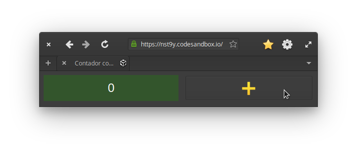

#+PROPERTY: header-args:js  :exports code
#+EXPORT_FILE_NAME: ../latex/capitulos/comparacao

# header-args is needed to use src_js{} for inline source code

* Delineamento
** As interfaces e as exigências de coordenação

  O conjunto de interfaces é um /benchmark/ de notação, como os /benchmarks/
  de resultado qualitativo do projeto de linguagens
  [[cite:erdweg2015][p. 35]], entre os quais está o 7GUIs
  [[cite:lu2021][p. 8:20]].

  Das sete interfaces, quatro adaptam casos do 7GUIs: o Contador, o
  /Counter/; a Reserva de Passagem, o /Flight Booker/, com a viagem de
  ônibus no lugar do voo; a Planilha, o /Cells/; e o Desenhador de
  Círculos, o /Circle Drawer/ [[cite:kiss2014][p. 17, 25, 40 e 49]].
  O Login segue o painel de [[textcite:berry2020][p. 534]], e o Placar ao
  Vivo adapta a placares de jogos as cotações que uma fonte manda aos
  clientes, de [[textcite:meijer2012][p. 66]].
  A Busca traz o cancelamento de uma requisição já começada, cuja
  resposta atrasada nunca aparece, comportamento assíncrono que nenhum
  dos casos do 7GUIs testa, como reconhece [[textcite:kiss2014][p. 77]].
  Cada interface exige da coordenação o que segue, com o que isso dá ao
  usuário e, entre parênteses, o nome das exigências:

  - Contador: :: um número e um botão que soma um a ele, sem exigência de
    coordenação própria, o mínimo de código que cada tecnologia pede para
    uma interface;
  - Busca com Sugestões: :: um campo de destino que sugere cidades a cada
    termo novo de duas letras ou mais e cancela a busca do termo anterior,
    para o usuário nunca ver as sugestões de um termo que já mudou
    (assincronia, ciclo de vida da requisição, lista derivada e
    histórico);
  - Login com Quarentena: :: um painel de nome e senha em que um novo
    clique em Entrar cancela a tentativa anterior, para o usuário que errou
    a senha tentar de novo sem esperar a resposta dela, e a sessão que
    expira sozinha, com um relógio que para quando ela se encerra
    (assincronia, ciclo de vida do relógio e estado derivado);
  - Placar ao Vivo: :: um painel de placares que uma fonte envia sem o
    usuário pedir, numa conexão aberta ao entrar na página, para ele seguir
    os jogos, e fechada ao pausar e ao sair dela, para ele ler a tabela
    parada e não gastar rede com o que não vê (assincronia de uma fonte de
    fora, ciclo de vida da conexão, estado derivado, lista derivada e
    histórico);
  - Reserva de Passagem: :: um formulário de passagem de ônibus com o tipo
    de viagem e duas datas, em que a data de volta só se habilita em ida e
    volta e se marca como inválida quando é anterior à ida, para o usuário
    saber por que não pode reservar, e o envio que ignora um novo clique
    em Reservar até a resposta, para a mesma reserva não sair duas vezes
    (estado derivado das duas datas, assincronia e ciclo de vida do envio
    e histórico);
  - Planilha: :: uma coluna de oito células com o orçamento do mês e a
    barra de fórmula, em que a alteração de uma célula se propaga só às
    que dependem dela, para o usuário ver o saldo na hora em que muda um
    gasto (estado derivado por um grafo que o usuário escreve, estado
    compartilhado entre a grade e a barra e lista derivada);
  - Desenhador de Círculos: :: um /canvas/ em que o clique desenha um
    círculo, o diâmetro ajustado num diálogo que guarda o círculo escolhido
    e o desfazer e o refazer de cada passo, para o usuário corrigir o
    desenho sem recomeçar (histórico, lista derivada e estado derivado).

** As tecnologias e os passos

  O núcleo tem duas tecnologias, o Web Component e o React, que
  implementam as sete interfaces na primeira e na segunda rodada.
  O Web Component é a forma do próprio navegador de criar elementos
  personalizados, sem biblioteca: uma classe que estende =HTMLElement= e
  que o navegador chama cite:mozilla2026.
  Nele, o tratador de cada evento atribui o valor novo ao estado e escreve
  também a atualização de cada elemento da tela que depende dele, a
  orquestração por atribuição e a propagação manual.
  No React, a tela se monta em JSX, marcação parecida com [[gls:html]]
  escrita dentro do JavaScript cite:meta2026c.
  O tratador também atribui o valor novo ao estado, mas não escreve a
  atualização da tela: quando o estado se altera, o React reexecuta o
  componente inteiro [[cites:&lee2025 p. 289:38;&solidjs2026]], a
  propagação por re-renderização.

  O passo do Web Component ao React muda a propagação, de manual a
  re-renderização, e deixa a orquestração por atribuição nos dois.
  O nome de cada modo diz como a alteração do estado chega à tela, e não
  como a tela se monta, e o mesmo passo muda duas coisas que o
  delineamento não controla.
  Uma é a montagem da tela.
  Nas implementações deste trabalho, o esqueleto da tela do Web Component
  fica em [[gls:html]] num texto, e só as partes que o estado repete ou põe
  e tira da tela se montam elemento a elemento, com =createElement=.
  No React, a tela inteira se monta em JSX.
  A outra é o modelo de componente, de uma classe a uma função.
  A análise atribui cada diferença pelo sinal escrito na notação: se ele
  está na coordenação, na montagem da tela ou na ligação entre as duas.

  O Web Component entra no núcleo como o extremo imperativo controlado,
  sem biblioteca, e não como o representante do que se usa na prática.
  O jQuery, na mesma célula, é a terceira tecnologia web mais usada entre
  quem respondeu à pesquisa do Stack Overflow de 2025, com 23,4%
  cite:stackoverflow2025.
  Ficou de fora porque não organiza a tela em componentes: o passo dele
  ao React acrescentaria um componente onde não havia nenhum.

  Na terceira rodada, na Busca, no Login e no Placar ao Vivo, o núcleo
  anda também na orquestração, sem trocar de tecnologia.
  O =useReducer= leva o React à orquestração por mensagem: cada evento
  vira uma ação, e uma função pura, o /reducer/, recebe o estado e a ação
  e devolve o estado seguinte cite:meta2026d.
  O RxJS leva o Web Component e o React à orquestração por acumulação, em
  que o estado se define sobre o fluxo de eventos, e, no último passo,
  leva os derivados do React aos combinadores.

  Depois da análise, o entorno do núcleo situa as células vizinhas, com
  cada tecnologia num passo a partir de uma implementação do núcleo.
  Na primeira rodada, nas sete interfaces, o Lit parte do Web Component,
  e o Solid, do React.
  O Lit se constrói sobre o Web Component: o componente continua uma
  classe que o navegador chama como elemento personalizado, mas a
  alteração de uma propriedade reativa agenda um ciclo de atualização,
  que chama de novo o =render()= e atualiza a tela pelo /template/
  [[cites:&google2026d;&google2026e]].
  O passo muda a propagação, de manual a re-renderização, e, com ela, a
  montagem das partes repetidas, que passa do =createElement= ao =map= no
  /template/.
  Alterar um objeto ou uma lista sem trocar a referência não dispara a
  atualização.
  A documentação recomenda, na maioria das aplicações, tratar os dados
  como imutáveis, mas admite, quando o dado serve a um componente só,
  alterá-lo no lugar e pedir a atualização com =requestUpdate()=
  cite:google2026e.
  É o que fazem o Desenhador de Círculos e a Planilha, que alteram a
  lista e os mapas no lugar, como no Web Component.
  No Solid, a tela também se monta em JSX, mas o componente não se
  reexecuta, e a alteração de um /signal/ atualiza só os trechos da tela
  que dependem dele [[cites:&lee2025 p. 289:38;&solidjs2026]]: o passo
  muda a propagação, de re-renderização a granular.

  Na Busca, no Login e no Placar ao Vivo, o Web Component com Effection
  parte do Web Component da segunda rodada e muda a orquestração, de
  atribuição a sequencial.
  Na orquestração sequencial, o código espera o próximo evento e segue
  em ordem.
  O Cycle.js parte do React com os derivados no RxJS, o último passo da
  terceira rodada, e muda de uma vez a biblioteca de fluxos, o modelo de
  componente, os efeitos e a montagem da tela.
  A diferença nesse passo não se atribui a uma variável só, como nos
  casos de [[textcite:kiss2014][p. 23]], em que o /toolkit/ pesou mais
  que o paradigma.
  Se o prazo não der para tudo, o entorno sai antes do resto, uma
  tecnologia por vez, nesta ordem: o Lit, na mesma célula do React; o
  Web Component com Effection; o Solid; e o Cycle.js.

** As rodadas

  A avaliação se faz em três rodadas, cada uma mais estreita que a
  anterior, como as de [[textcite:kiss2014][p. 3]]: a primeira responde à
  P1, e a segunda e a terceira, à P1.1 e à P1.2.
  Cada rodada lê um eixo: a primeira, a propagação; a segunda, o
  crescimento do código; a terceira, a orquestração.

  Na primeira rodada, o Web Component e o React implementam as sete
  interfaces, 14 implementações, cada uma só com o que a tecnologia traz.
  A orquestração é por atribuição nas duas, e a diferença entre elas está
  na propagação, manual numa e por re-renderização na outra.

  A segunda rodada muda o comportamento e faz o código crescer, porque é
  nos problemas grandes que os efeitos da viscosidade mais aparecem
  [[cite:green1996d][p. 161]].
  Cada interface recebe funcionalidades, que mudam o que o usuário
  percebe ou pode fazer, e requisitos de combinação de eventos, que deixam
  a tela igual e mudam só como os eventos se combinam.
  São 13 mudanças, numa ordem fixada antes da análise, cada uma num
  /commit/ no Web Component e depois num no React, 26 /commits/ ao todo:

  - Contador: :: a lista de contadores, com a remoção de um deles e o
    total derivado, para o usuário contar várias coisas ao mesmo tempo;
  - Reserva de Passagem: :: a data de volta empurrada ao dia seguinte à
    ida quando a ida passa dela, para o usuário não ter de corrigir a
    volta;
  - Busca com Sugestões: :: a espera de 300 ms depois da última tecla,
    para as sugestões não mudarem a cada letra, e o /combobox/ operável
    pelo teclado, para quem não usa o mouse escolher uma sugestão;
  - Login com Quarentena: :: a quarentena depois de três falhas seguidas,
    que [[textcite:berry2020][p. 539]] acrescentam ao painel na segunda
    versão dele, para proteger a conta de quem tenta adivinhar a senha, e
    o "lembrar meu nome", para o usuário não digitar o nome a cada
    entrada;
  - Placar ao Vivo: :: a queda da conexão, que o navegador refaz sozinho
    [[cite:whatwg2026][§ 9.2.1]], com o aviso "Reconectando…" até o
    próximo lote, para o usuário saber que a tabela parou por queda, e não
    por pausa; o bolão, com os pontos de cada palpite e o total
    derivados, para o usuário ver quantos pontos fez; e a frequência de 1,
    5 ou 10 s, que vai ao servidor numa requisição à parte, para o usuário
    escolher de quanto em quanto tempo os placares mudam;
  - Planilha: :: a referência circular, que a Planilha acusa sem avaliar o
    ciclo, a exigência com que [[textcite:kiss2014][p. 54]] discute a
    viscosidade do /Cells/, para o usuário ver o erro em vez de a planilha
    travar;
  - Desenhador de Círculos: :: arrastar os círculos, com o arraste no
    desfazer, para o usuário mudar um círculo de lugar sem desfazer e
    desenhar de novo; salvar o desenho num servidor simulado, na ordem
    das mudanças, para o desenho não se perder; e o campo numérico do
    diâmetro, ligado ao /slider/ nos dois sentidos, para o usuário
    digitar o diâmetro exato.

  Latências, tentativas, prazos e intervalos ficam fixos no domínio,
  iguais nas duas tecnologias.

  A terceira rodada muda só a forma: refatora o código da segunda rodada
  da Busca, do Login e do Placar ao Vivo, as interfaces em que a
  combinação de eventos pesa.
  O comportamento não muda, e o teste de conformidade e as cenas da
  segunda rodada servem de rede.
  São cinco passos por interface, cada um num modo de um eixo, 15
  refatorações ao todo:

  - do Web Component ao Web Component com RxJS, a orquestração, de
    atribuição a acumulação, com os derivados ainda escritos à mão no
    /listener/;
  - do React ao React com =useReducer=, a orquestração, de atribuição a
    mensagem;
  - do React com =useReducer= ao React com RxJS, a orquestração, de
    mensagem a acumulação, com o mesmo /reducer/ no =scan=;
  - do Web Component com RxJS ao React com RxJS, a propagação, de manual
    a re-renderização;
  - do React com RxJS ao React com os derivados no RxJS, a propagação dos
    derivados, do corpo do componente aos combinadores.

  O Web Component, o React e os dois com RxJS formam um quadrado, em que
  se lê se a diferença num eixo depende do modo no outro.
  No React com RxJS, os derivados ficam no corpo do componente, forma
  escolhida para que o passo seguinte mude só os derivados.

  Se o prazo apertar, depois do entorno saem, nesta ordem, fixada antes
  da análise: o bolão, o "lembrar meu nome" e o Login na terceira rodada.
  Cada mudança sai inteira, nas duas tecnologias.
  Não saem a primeira rodada nem a Busca e o Placar ao Vivo na terceira.
  Também ficam a lista de contadores e o campo do diâmetro, as únicas
  mudanças que trazem a remoção com a identidade dos que ficam e a
  ligação nos dois sentidos.

** Os controles e o teste de conformidade

  Seis coisas poderiam diferenciar as implementações sem ser o modelo de
  programação nem a notação, e as seis ficam fixas: a linguagem, a
  especificação, as dependências, o domínio, a aparência e as versões.
  Esse controle das variáveis é parte do planejamento da pesquisa, o
  delineamento [[cite:prodanov2013][p. 54]].

  Todas as implementações estão na web, em /TypeScript/ no modo estrito.
  As de uma interface seguem a mesma especificação, com os mesmos textos,
  regras e dados, e cada mudança da segunda rodada entra na especificação
  antes do código.
  Cada implementação usa só o que a tecnologia traz, sem bibliotecas além
  das que fazem parte dela: o RxJS nos passos da terceira rodada e, no
  entorno, o Effection e o Cycle.js.
  As regras que não dependem da tela, como o formato das datas, as
  mensagens, os servidores simulados e a análise das fórmulas da
  Planilha, ficam num /domínio/ comum às implementações de cada
  interface; o Contador não tem nenhuma.
  A alteração do estado, como a propagação da Planilha e o desfazer do
  Desenhador de Círculos, fica em cada implementação, para que a
  diferença entre alterar no lugar e trocar por uma cópia não saia da
  análise.

  Na primeira rodada, duas regras valem para todas as interfaces.
  As mensagens de situação ficam numa região que o leitor de tela anuncia
  sem mover o foco, e a interface que sai da tela encerra o que abriu:
  relógios, conexões, requisições e ouvintes.

  Um /teste de conformidade/ por interface executa as mesmas verificações,
  na mesma ordem, contra cada implementação, cada uma com o nome de um
  cenário da especificação.
  Ele se cola no console do navegador, com a implementação aberta, ou roda
  por um comando que abre cada implementação no Chromium.
  O teste confere também as mensagens de situação e, nas interfaces que
  abrem relógios, conexões, requisições ou ouvintes, a limpeza ao sair da
  tela.
  /Capturas/ de tela dos estados escolhidos de cada interface, geradas
  automaticamente, denunciam desvios de comportamento ou de aparência,
  porque devem sair idênticas entre as tecnologias.
  As implementações, os testes de conformidade e as capturas ficam num
  repositório público, em https://github.com/iquabius/unemat-tcc.
  Nele, as versões da linguagem, das bibliotecas e das ferramentas ficam
  fixadas[fn:versoes], para que as implementações possam ser reproduzidas.

  Na aparência, que fica fixa num arquivo [[gls:css]] comum às
  implementações de cada interface, a tela só cita as classes pelo nome.
  As capturas de tela conferem que ela sai igual em todas as tecnologias.
  Só o valor que depende do estado, como a posição de um menu, entra na
  notação.

  Com a aparência fora da notação, a avaliação não vê o estilo escrito
  junto do componente, no próprio código que monta a tela.
  Também não chega às dependências ocultas que
  [[textcite:green2006][p. 342]] acham no sistema formado pelo [[gls:html]]
  e pelo [[gls:css]].

** A avaliação

  A avaliação cabe ao autor, que examina o código das implementações dimensão
  a dimensão, sem participantes.
  É uma avaliação analítica, feita por especialista, sem a participação de
  usuários cite:blandford2008, como a de [[textcite:kiss2014][p. 8]] pelas
  [[glspl:dc]].
  Ela serve de alternativa aos estudos com programadores, que comparam
  linguagens a custo alto e com resultados muitas vezes inconclusivos
  [[cite:sadowski2011][p. 9]], e as [[glspl:dc]] pedem menos tempo que eles
  cite:dagit2006.

  Em cada rodada, a avaliação percorre as 14 [[glspl:dc]] da lista
  completa [[cite:blackwell2003][p. 115-118]], e não um subconjunto
  escolhido antes, porque a escolha prévia pode atrapalhar, e o conjunto
  inteiro traz resultados inesperados e úteis [[cite:blackwell2001][p. 332]].
  Para a análise, o trabalho as agrupa pelo que descrevem.
  Oito tratam da notação: /nível de abstração/, /proximidade de
  descrição/, /consistência/, /concisão/, /operações mentais difíceis/,
  /dependências ocultas/, /expressividade de papel/ e /notação secundária/.
  Duas são do sistema, que o ambiente de edição agrava ou atenua: a
  /viscosidade/ e a /propensão a erros/.
  As outras quatro pesam no ambiente de edição: o /compromisso
  prematuro/, a /avaliação progressiva/, a /visibilidade/ e a
  /provisoriedade/.
  Destas, a avaliação lê a face que aparece na notação, porque os próprios
  autores suspeitam que há uma zona cinzenta entre as dimensões da notação e as
  do ambiente [[cite:green2006][p. 357]].
  Nenhuma dimensão é boa ou má em si, e a avaliação sempre leva em conta a
  atividade a apoiar [[cite:blackwell2003][p. 115]].
  Na primeira rodada, as atividades são a busca e a compreensão exploratória
  do código pronto, e, na segunda e na terceira, a modificação [[cite:blackwell2003][p. 113]].

  A análise é por interface, como os casos de
  [[textcite:kiss2014][p. 17-55]], um por seção.
  A seção de cada interface traz a especificação curta, as cenas, a
  captura da tela e, logo abaixo, o módulo principal do Web Component e
  do React, inteiro menos os =import=, com as linhas numeradas.
  Seguem as 14 [[glspl:dc]], cada uma em poucas linhas, que citam as linhas
  da listagem em vez de repetir o trecho, com "sem diferença" quando os
  modelos de programação não diferem nela.
  Em cada [[gls:dc]], a análise aponta se a diferença está na coordenação,
  na montagem da tela ou na ligação entre as duas.
  Na mesma seção ficam as rodadas da interface: a segunda, com o /diff/
  de cada mudança, e, na Busca, no Login e no Placar ao Vivo, a terceira,
  com os cinco passos.
  Cada passo entra como /diff/ quando ele é mais curto que a listagem
  nova, senão como a listagem nova inteira, com as linhas que mudaram
  realçadas, e o entorno segue a mesma regra depois da análise.
  O anexo guarda só o domínio de cada interface.
  Como as sete interfaces se leem inteiras, o avaliador não escolhe a
  interface que dá a evidência de cada [[gls:dc]], nem antes nem depois de
  ver o código.

  Na segunda e na terceira rodada, o /diff/ de cada mudança apoia a
  viscosidade: a mesma mudança, preparada antes e feita em cada
  implementação, como no teste de [[textcite:green1996d][p. 162]], mostra
  quantas ações ela pede, e quantas outras restauram a consistência
  [[cite:blackwell2003][p. 115]].
  A concisão tem ainda o apoio de uma contagem das linhas não vazias e
  sem comentários de cada implementação, sem o domínio e o estilo.

  A comparação fecha numa tabela-síntese, que reúne o perfil de cada
  modelo de programação nas [[glspl:dc]] [[cite:blackwell2003][p. 107-108 e 118]],
  com uma linha por [[gls:dc]] e uma coluna por modelo: duas na primeira e
  na segunda rodada, e seis com a terceira.
  Cada célula dá a posição do modelo na [[gls:dc]] e de que interface vem a
  evidência, e a mesma tabela se lê por exigência de coordenação.
  Da primeira rodada para as outras duas, a linha de cada [[gls:dc]] diz se
  a diferença entre os modelos de programação fica /mantida/,
  /ampliada/, /reduzida/, /anulada/, /invertida/ ou /surgida/, e a célula
  diz se a posição do modelo /sobe/, /desce/ ou /fica igual/.

  Quem avalia pelas [[glspl:dc]] o que construiu tem conflito de
  interesse e, num sistema implementado ao longo de muito tempo, tende a não
  ver os problemas que se acostumou a contornar cite:dagit2006.
  O conflito diminui num sistema ainda em formação, e usar as [[glspl:dc]]
  tarde no próprio sistema é melhor do que não usá-las cite:dagit2006.

  Quatro das 14 [[glspl:dc]] pesam no ambiente de edição, e este trabalho as
  lê só pela face que aparece na notação, onde podem mostrar pouca diferença
  no código.
  Elas entram mesmo assim, porque escolher de antemão um subconjunto das
  [[glspl:dc]] pode ser pouco útil [[cite:blackwell2001][p. 332]].
  Para [[textcite:green2006][p. 334]], duas das outras, a expressividade de
  papel e as operações mentais difíceis, sempre foram mal descritas.
  Na tabela-síntese, os rótulos do que acontece com a diferença de uma
  rodada a outra, /mantida/, /ampliada/, /reduzida/, /anulada/,
  /invertida/ ou /surgida/, são deste trabalho, e não de uma fonte.

* Dimensões de avaliação
  @@latex:\todo{Trecho vindo da introdução no corte de outubro de 2026, ainda por integrar a esta seção.}@@
  A avaliação usa as [[glspl:dc]], que [[textcite:blackwell2003][p. 106]] chamam de ferramentas
  de discussão, para quem projeta ou avalia artefatos de informação, e não
  de método analítico.

  [[textcite:blackwell2019][p. 58 e 60]] registram, na psicologia da
  programação, o pedido por ensaios controlados randomizados no estudo do
  projeto de linguagens e o ceticismo sobre apoiar nesse empirismo um
  processo de projeto complexo.
  Para eles, a parte cognitiva das [[glspl:dc]] importa bem menos que a teoria de
  projeto implícita nelas.

  As [[glspl:dc]] de textcite:green1989 são um conjunto estabelecido de
  dimensões, o que facilita a comparação dos resultados com os de outros
  trabalhos baseados nelas, como argumenta [[textcite:kiss2014][p. 12]],
  que usou um subconjunto delas.

  # Traduzidas diretamente de KISS 2014
  - Nível de abstração :: /Disponibilidade e tipos de mecanismos de abstração/

       O sistema fornece alguma forma de definir novos termos com a notação pra
       que eles possam ser extendidos afim de descrever ideias claramente? Os
       detalhes podem ser encapsulados? O sistema insiste em definir novos
       termos? Qual o número de novos conceitos de alto nível devem ser
       aprendidos pra se fazer uso do sistema? Eles são fáceis de aprender e
       usar?

       Cada novo conceito é um empecilho pra aprendizagem e aceitação, mas
    também pode tornar um código complexo mais compreensível. Por exemplo, o
    React emprega o /fluxo de dados de mão única/ --- do inglês /one-way data
    flow/ ou /one-way binding/ --- em sua arquitetura. É necessário aprender
    conceitos novos para usar os componentes do React de forma adequada. Não
    compensa para aplicações pequenas, mas para aplicações complexas pode tornar
    o código mais compreensível e passível de manutenção porque os detalhes
    podem ser encapsulados em novos termos: os componentes.
    # maintainable: passível de manutenção, sustentável

    Outro exemplo é a função:

    #+begin_export latex
    \begin{citacao}
      A function has a name and, optionally, parameters as well as a body that
      returns a value following certain computational steps. A client can simply
      refer to a function by its name without knowing its implementation details.
      Accordingly, a function abstracts the computational process involved in the
      computation of a value. The learning barrier to the principle of a function is
      not great but it can still make a lot of code much more understandable 3 by
      hiding unimportant details.
      \cite[p.~13]{kiss2014}
    \end{citacao}
    #+end_export

  - Proximidade de descrição :: \todo{Traduzido de “Closeness of mapping”, poderia ser “Proximidade de mapeamento”} /Semelhança entre representação e o domínio/

       O quão relacionado é a notação com o resultado que ela descreve, ou
       melhor, o domínio do problema? Que partes parecem ser uma forma
       particularmente estranha de descrever algo?

       #+begin_export latex
       \begin{citacao}
         Um exemplo é a definição de layout de uma interface gráfica. Linguagens que
         não fornecem uma forma de descrever o layout de modo aninhado, ou seja,
         hierárquico, e como tal força o programador a “linearizar” o código com o uso
         desnecessário de variáveis intermediárias, dificultando enchergar como a
         estrutura de definição do layout corresponde com o layout final da aplicação.
         Não é atoa que especificações baseadas no XML são amplamente usadas na
         construção de interfaces gráficas em linguagens sem suporte nativo para
         representação hierárquica de layout.
         \cite[p.~13; tradução nossa]{kiss2014}
       \end{citacao}
       #+end_export

  - Dependências ocultas :: /Vínculos importantes implícitos entre entidades/

       As dependências entre as entidades da notação são visíveis ou ocultas?
       Todas as dependências são especificadas em ambas as direções? Alterações
       locais podem ter efeitos globais confusos?

       Se uma entidade cita outra, que por sua vez cita uma terceira, a
       alteração do valor da terceira entidade pode desencadear efeitos
       inesperados. O principal problema não é o fato de A depender de B, mas sim
       que a dependência não é explicitamente visível. Um caso bem conhecido de dependência
       oculta é o “problema da classe base frágil”[fn:fragile_base_class].

       # https://medium.com/ui-lab-school/guia-para-dimensoes-cognitivas-no-design-72d898a62bc7

       #+begin_export latex
       \begin{citacao}
         In (complex) class hierarchies a seemingly safe modification to a base class
         may cause derived classes to malfunction. The IDE in general cannot help
         discovering such problems and only certain programming language features can
         help preventing them. Another example are non-local side-effects in
         procedures, i.e. the dependencies of a procedure with non-local side-effects
         are not visible in its signature.
         \cite[pg.~14]{kiss2014}
       \end{citacao}
       #+end_export

  - Propensão a erros :: /Notação incita erros/

       Até que ponto a notação influência o programador a cometer um erro? Fazer
       algumas coisas parece ser particularmente complexo ou difícil, p. ex.,
       juntar várias coisas?
       # TODO: Melhorar, pois Berndt perguntou “o que são essas coisas?”

       Em muitas linguagens dinâmicas com definições implícitas de
       variáveis[fn:var_implicit_def], um erro de tipagem em uma variável pode
       de repente causar erros difíceis de encontrar já que o [[gls:ide]] nem sempre
       pode apontar tal erro devido a dinamicidade na linguagem. A inicialização
       implícita de variáveis com valor =null= pode levar a uma exceção de
       ponteiro nulo se o programador esquecer de inicializar as variáveis
       corretamente antes de usá-las.

  - Concisão         :: /Verbosidade da linguagem/
       # Diffuseness/terseness: difusão/concisão, ou dispersão
       Quantos símbolos ou quanto espaço a notação requer pra produzir um certo
       resultado ou expressar uma ideia. Que tipos de coisas ocupam mais espaço
       para se descrever?

       #+begin_export latex
       \begin{citacao}
         Some notations can be annoyingly long-winded, or occupy too much valuable
         “real-estate” within a display area. In Java before version 8 in order to
         express what are lambdas today anonymous classes were employed. Compared to
         Java 8’s lambdas these anonymous classes used to be a very verbose way of
         encoding anonymous functions especially when used in a callback-heavy setting
         like traditional GUI programming~\cite[p.~14]{kiss2014}.
         \todo[inline]{Pensar num exemplo mais próximo da Web e substituir citação direta.}
       \end{citacao}
       #+end_export

       # TODO: Comentar que concisão a custo de intenção explícita prejudica
       # legibilidade.

  - Viscosidade     :: /Resistência a mudanças/

       Existe alguma barreira contra mudança na notação? Quanto esforço é
       necessário pra fazer uma alteração num programa expresso na notação?

       Num sistema viscoso o usuário precisa realizar várias passos para
       concluir uma tarefa. Alterar o tipo de retorno de uma função pode causar
       erros em várias partes do código onde a função é chamada. Nesses casos um
       [[gls:ide]] pode ajudar muito.

  As outras oito dimensões da lista completa são:

  - Compromisso prematuro: /limitações na ordem de fazer as coisas/
  - Expressividade de papel: /o propósito de uma entidade pode ser rapidamente determinado/
  - Consistência: /semânticas parecidas são apresentadas em estilo sintático
    parecido/
  - Operações mentais difíceis: /alto esforço cognitivo pra realizar tarefas/
  - Notação secundária: /informações extras por meio de notações além das
    formais/
  - Visibilidade: /habilidade de ver os componentes claramente/
  - Avaliação progressiva: /trabalho realizado pode ser verificado em qualquer
    momento/
  - Provisoriedade: /grau
    de comprometimento com uma ação ou marco/

  # progressive evaluation: análise/verificação
  # provisionality: momentaneidade, transitoriedade, provisoriedade

  # Uma operação mental difícil é a leitura de um laço “for”. O usuário precisa
  # manter na memória os valores de todas as variáveis intermediárias envolvidas
  # na iteração. É um mal sinal se o usuário precisa fazer um teste de mesa para
  # entender a lógica.

  # “Uma notação pode tornar as coisas desnecessariamente complexas para o
  # usuário se ele faz exigências excessivas na sua memória de curta duração.”

  # “É um mau sinal se o usuário precisa usar um bloco de notas para fazer
  # anotações ao invés de continuar usando o sistema.”

  # https://medium.com/ui-lab-school/guia-para-dimensoes-cognitivas-no-design-72d898a62bc7

* *Revisão do JavaScript
  # TODO: Berndt disse p/ colocar como apêndice

  Talvez devêssemos colocar uma seção de revisão das ferramentas utilizadas na
  implementação dos estudos de caso? Poderíamos descrever os recursos relevantes
  para nossa análise.
  \todo[noline]{Berndt disse p/ colocar como apêndice}

* Processamento de listas

  Uma coleção é um agrupamento com uma quantidade variável de itens, que (1)
  compartilham algum significado ao problema a se resolver e (2) precisam ser
  manipulados juntos de forma controlada.

  O único tipo de coleção no JavaScript é o arranjo, ou /array/, que pode ser
  construído através do objeto[fn:prototypes] global src_js{Array}, ou da
  notação de arranjos literais com colchetes:

  # TODO: find a way to insert a '\legend{}' before '\end{listing}' for the
  # reference. Take a look at function org-latex-src-block in ox-latex.
  #+caption: Criando coleções
  #+begin_src js
  var collection1 = new Array();
  var collection2 = [];
  #+end_src

  Uma tarefa muito comum na programação é a iteração[fn:iteration] de coleções.
  Um mecanismo muito utilizado para tal é o comando src_js{for}. Em
  \ref{code:forLoopTraverse} é demonstrado o uso do comando src_js{for} para
  percorrer os itens da coleção src_js{people} e mostrar cada um no console de
  depuração.

  #+caption: Percorrendo uma coleção com o laço src_js{for}
  #+name: code:forLoopTraverse
  #+BEGIN_SRC js
  var people = ["Alan Turing", "Alonzo Church", "Kurt Gödel"];
  var count  = 0;

  for (count = 0; count < people.length; count++) {
    console.log(people[count]);
  }
  #+END_SRC

** Formatação de preços

   Nesta seção veremos como formatar uma lista preços para serem mostrados na
   tela, p. ex., transformando um valor numérico src_js{50.45} em uma /string/
   src_js{"R$ 50.45"}. Para isso usamos uma função de formatação que é aplicada
   a cada valor da lista. A função de formatação pode ser observada em
   ref:code:formatPriceFunction.
   # Esse processo de transformação é chamado de projeção

   #+caption: Função pra formatar um preço
   #+name: code:formatPriceFunction
   #+BEGIN_SRC js
   function formatPrice(price) {
     return 'R$' + price.toFixed(2);
   }
   #+END_SRC

   Em ref:code:formatPricesFor pode-se ver a solução implementada com o laço
   src_js{for}.

   #+caption: Formatação de preços com laço src_js{for}
   #+name: code:formatPricesFor
   #+BEGIN_SRC js
   const prices = [50.45, 47, 20.99, 3.44, 1];
   let formatedPrices = [];

   for (let i = 0; i < prices.length; i++) {
     formatedPrices.push(formatPrice(prices[i]));
   }
   #+END_SRC

   Em ref:code:formatPricesMap pode-se ver a solução implementada com a função
   src_js{map}.

   #+caption: Formatação de preços com laço src_js{for}
   #+name: code:formatPricesMap
   #+BEGIN_SRC js
   const prices = [50.45, 47, 20.99, 3.44, 1];

   const formatedPrices = prices.map(formatPrice);
   #+END_SRC

   Outras ideias:

   - Adicionar $1$ a cada número de uma lista
   - Multiplicar os números de uma lista
   - Transformar palavras com letras minúsculas de uma lista em palavras com
     letras maiúsculas

** Seleção de valores com =filter()=
   Remover nomes que não começam com ‘S’

** Nivelamento de valores com =concatAll()=
** Redução de valores com ~reduce()~

   O método src_js{reduce()} executa uma função *reducer* para cada item da
   lista, resultando num único valor. Em ref:code:somaDePreçosComReduce é
   demostrado a soma dos preços de uma lista usando o método src_js{reduce()}.
   Nesta demonstração a função src_js{somar()} é o *reducer*.
   # https://developer.mozilla.org/pt-BR/docs/Web/JavaScript/Reference/Global_Objects/Array/Reduce

   #+caption: Soma dos preços de uma lista com o método src_js{reduce()}.
   #+name: code:somaDePreçosComReduce
   #+begin_src js
   const preços = [50.45, 47, 20.99, 3.44, 1];

   const somar = (a, b) => a + b;
   const total = preços.reduce(somar);
   #+end_src

** Agrupamento de valores com ~zip()~

* Coordenação de eventos
  @@latex:\todo{Trecho vindo da introdução no corte de outubro de 2026, ainda por integrar a esta seção.}@@
  A triagem em geral se apoia no que se escreveu sobre as alternativas, e não
  no uso delas [[cite:kitchenham1996][p. 15]].
  Aqui, ela se apoia também no uso de duas das notações, porque o autor
  escreveu implementações de referência em React e em JavaScript com
  /callbacks/.
  Na escrita das implementações, a familiaridade desigual do autor pesa
  menos, porque elas seguem a mesma especificação e são padronizadas entre
  as tecnologias.

  [[textcite:kiss2014][p. 11]] também compara as implementações pela
  usabilidade do código, e não por tempo de execução e memória, como num
  /benchmark/ tradicional.

  No Web Component, as tarefas de cada coluna do Quadro se criam com
  =map=, função de [[gls:pf]].
  E, no React, no Solid e no Angular com /signals/, o estado do Quadro se
  grava no armazenamento do navegador, um sistema externo, por um efeito.
  A documentação do React chama os efeitos de “uma saída de emergência do
  paradigma do React” [[cite:meta2026b][tradução nossa]].

  Das sete interfaces do 7GUIs, só o /Flight Booker/ fica no conjunto,
  adaptado no Formulário [[cite:kiss2014][p. 25]].
  O /Timer/ trata da concorrência entre um relógio e o usuário, mas nenhuma
  das sete faz uma requisição cujas respostas chegam fora de ordem ou são
  canceladas [[cite:kiss2014][p. 30]].
  E nenhuma põe componentes independentes para ler e alterar o mesmo
  estado, como o cabeçalho e as três colunas do Quadro.

  No React, um valor derivado é uma expressão comum, recalculada a cada
  execução do componente cite:meta2026b.
  No Solid, é uma função que lê o /signal/ cite:solidjs2026a.

  No Android, as duas variantes são escritas em Kotlin, a linguagem que o
  Android recomenda e a única em que o Compose se escreve cite:android2026a.
  O domínio em Kotlin responde diferente do da web em entradas-limite, como
  anos de 0 a 99, e cada diferença conhecida fica registrada num teste.
  Entre Views e Compose, a única diferença admitida nas capturas é a de
  poucos pixels na renderização do texto.

** Contador

   # estrutura mínima
   - Problema :: entender os conceitos essenciais da linguagem e a estrutura
     básica necessária

   #+CAPTION: Interface gráfica do Contador.
   #+NAME: img:contador
   #+ATTR_LATEX: :width 12cm :center t
   
   # https://stackoverflow.com/a/42170221/1787829
   # Ctrl-c Ctrl-l (org-insert-link) -> “file:”
   # Dá pra configurar o :width globalmente

   A implementação do contador usando classes poder ser observado em
   ref:code:contadorComPOO.

   #+caption: Contador com POO.
   #+name: code:contadorComPOO
   #+BEGIN_SRC js
   // No Java isto extenderia alguma classe padrão do toolkit,
   // como `Application`
   class Contador {
     constructor(props) {
       // Em Java estas propriedades precisam ser definidas antes
       this.contador = props.valorInicial;
       this.caixaDoValor = document.getElementById("valor");
       this.botãoDeIncrementar = document.getElementById("botãoDeIncrementar");
       this.botãoDeIncrementar.addEventListener(
         "click",
         // Isto requer uma explicação um tanto extensa
         this.tratarClique.bind(this)
       );
     }

     tratarClique(_evento) {
       this.contador = this.contador + 1;
       this.renderizar();
     }

     // Equivalente ao `public static void main()` do Java
     renderizar() {
       this.caixaDoValor.innerText = this.contador;
     }
   }

   const contador = new Contador({ valorInicial: 0 });
   // Como no Java o `main()` é padronizado, sua execução seria
   // feita automaticamente pelo ambiente de execução.
   contador.renderizar();
   #+END_SRC
   # https://codesandbox.io/s/contador-com-oop-callbacks-nst9y

   # Como fazer o ref se vincular com a linha no código? No LaTeX não está
   # funcionando: https://orgmode.org/manual/Literal-Examples.html
   O src_js{tratarClique.bind(this)} na linha 12 requer uma explicação um tanto
   extensa.

   O contador usando função e operadores do xstream pode ser observado em
   ref:code:contadorComPR.

   #+caption: Contador com PR.
   #+name: code:contadorComPR
   #+BEGIN_SRC js
   import fromEvent from "xstream/extra/fromEvent";

   const Contador = props => {
     const caixaDoValor = document.getElementById("valor");
     const botãoDeIncrementar = document.getElementById("botãoDeIncrementar");

     // Fluxo que emite um evento toda vez que o botão for clicado
     const cliqueStream = fromEvent(botãoDeIncrementar, "click");

     // Fluxo que emite "valor + 1" (acumulado) toda vez que
     // cliqueS emite um evento
     const contadorStream = cliqueStream.fold(
       (valor, _evento) => valor + 1,
       props.valorInicial
     );

     const observador = {
       next: valor => {
         caixaDoValor.innerText = valor;
       }
     };

     contadorStream.addListener(observador);
   };

   Contador({ valorInicial: 0 });
   #+END_SRC

   # O “$” quebra o LaTeX quando usado no comentário do código. A solução talvez
   # seja usar anotações/annotations: https://tex.stackexchange.com/a/86457/103967

*** Análise

    Essa primeira análise é focada no básico.

**** Nível de abstração
     Na solução com [[gls:poo]] os conceitos da linguagem que deve-se entender são:
     classes, construtor, objetos, propriedades, métodos, /callbacks/ na forma
     de método, e conhecimento da [[gls:api]] do objeto do documento do [[gls:html]] ---
     [[gls:dom]].
     Além do caso do src_js{this} específico do JavaScript:
     src_js{this.tratarClique.bind(this)}.
     Embora sejam conceitos básicos para um programador experiente em JavaScript
     e [[gls:poo]], o número é grande.
     Abstrações mais sofisticadas não são necessários pelo Contador e o sistema
     não insiste em abstrações especiais.
     Apesar da solução usar uma quantidade considerável de conceitos, eles são
     básicos, então observamos que o Nível de Abstração é baixo, ou seja, bom.

     Em contrapartida, na solução com [[gls:pr]] os conceitos usados são: funções,
     variáveis, fluxos e eventos, callbacks, e a [[gls:api]] do [[gls:dom]].
     A abstração mais sofisticada é o método src_js{fold()} do fluxo de evento,
     que nada mais é que uma versão assíncrona do src_js{Array.reduce()}
     nativo --- veja a soma de preços em ref:code:somaDePreçosComReduce.
     Ambos produzem um resultado para cada elemento da lista.
     A diferença é que no primeiro a lista é de eventos assíncronos, e infinita.
     No segundo a lista é síncrona, com valores escales (números, /strings/,
     objetos, etc.).
     \todo{Paralelo entre métodos assíncronos e síncronos em outra seção?}
     Níveis mais altos de abstração não são necessários, então a solução com [[gls:pr]]
     é igualmente boa ou um pouco melhor que a solução com [[gls:poo]] quanto ao Nível
     de Abstração.

**** Proximidade de descrição
     Essa dimensão faz mais sentido para análise de apresentação do que
     comportamento (coordenação de eventos).

**** Dependências ocultas
     \todo[noline]{Acredito que o HTML só não está situado no mesmo local que o código JavaScript, que é diferente de “oculto”.}
     As únicas dependências que podem ser consideradas ocultas são os elementos
     [[gls:html]] buscados pelo identificador com =document.getElementById("id")=.

**** Propensão a erros
     Na solução com [[gls:poo]], esquecer de vincular a instância do contador à função
     =tratarClique()= resultará no erro “TypeError: this.renderizar is not a
     function”.
     Pois o valor do =this= estará vinculado ao objeto que chamou
     =tratarClique()=, ou seja, o =this.botãoDeIncrementar=.
     \todo{Talvez isso seja uma dependência oculta?}
     Isso se deve ao fato de a palavra chave =this= se comportar de forma
     diferente no JavaScript quando comparado com outras linguagens.

     # https://developer.mozilla.org/pt-BR/docs/Web/JavaScript/Reference/Operators/this
     #+begin_quote
     In most cases, the value of this is determined by how a function is called
     (runtime binding). It can't be set by assignment during execution, and it
     may be different each time the function is called. ES5 introduced the
     bind() method to set the value of a function's this regardless of how it's
     called, and ES2015 introduced arrow functions which don't provide their own
     this binding (it retains the this value of the enclosing lexical context).
     cite:This2020.
     #+end_quote

     #+begin_export latex
     \todo[inline]{Nos próximos exemplos acredito que podemos usar as funções de seta
       como callback no lugar dos métodos, pois possuem o valor do this vinculado
       lexicalmente. O Java possui lambdas desde a versão 8, o que despensa o uso de
       métodos para casos como esse. Ou já removemos desse primeiro? Pra evitar ter
       que explicar o \texttt{.bind(this)} que é um problema específico do
       JavaScript}.
     #+end_export

     Na solução com [[gls:pr]], esquecer de definir o observador fará com que a
     =caixaDoValor= não seja atualizada.
     Pois ela não será renderizada, apesar de toda a lógica do contador
     funcionar.
     Apesar de tudo, essas possibilidades de erros não são críticas.

**** Concisão
     Na solução com [[gls:poo]] o método src_js{tratarClique()}, usado como /callback/,
     poderia ser substituído por uma função de seta.
     Além de poupar algumas linhas o uso do src_js{.bind(this)} se torna
     desnecessário.
     Veja o código do Contador com [[gls:poo]] e função de seta em
     ref:code:contadorComPOOeFuncDeSeta no apêndice.
     Na solução com [[gls:pr]] a variável intermediária src_js{contadorStream} poderia ser
     removida, encadeando a chamada do src_js{fromEvent} com o src_js{fold()}:
     src_js{const cliqueStream = fromEvent().fold()}.
     No entanto essa manobra diminuiria a legibilidade do
     código[fn:encadeamento].
     De qualquer forma, a [[gls:pr]] evita a verbosidade da declaração da classe e dos
     métodos, além da repetição do src_js{this}.
     Então em termos de Concisão a [[gls:pr]] está à frente da [[gls:poo]].

**** Viscosidade
     Num caso tão simples como o do Contador a única resistência a alteração
     está em renomear atributos no caso da [[gls:poo]], e variáveis na [[gls:pr]].
     No entanto isso é inevitável ao renomear termos.
     Além disso o [[gls:ide]] pode ajudar através de uma funcionalidade de refatoração.
     \todo{Talves seja interessante analisar a viscosidade da alteração pra colocar um botão de decremento (-1) do Contador.}

** Reserva de voo

Resultados aqui…

@@latex:\todo{Trecho vindo da introdução no corte de outubro de 2026, ainda por integrar a esta seção.}@@
Quando o Solid e o Angular com /signals/ divergem numa [[gls:dc]], a célula o
registra.
A seção de cada [[gls:dc]] cita as outras interfaces quando contradizem a escolhida, e a tabela
diz "sem diferença" quando nenhuma interface mostra uma.
A contagem de linhas deixa de fora as linhas vazias, os comentários, o
domínio e o estilo, e inclui a estrutura da tela, esteja ela no mesmo arquivo da
coordenação ou num arquivo à parte, como o [[gls:html]] da página no jQuery e o
layout [[gls:xml]] nas Views.

* Footnotes

[fn:versoes] No =package-lock.json=: TypeScript 6.0.3, React 19.3.0,
Solid 1.9.15 e Lit 3.3.3, com Vite 8.3.1 para o /build/ e Playwright
1.63.0 para as capturas e o teste de conformidade por comando.

[fn:encadeamento] Note que o nome da variável src_js{cliqueStream} já nem faz mais
sentido, pois o resultado da expressão não inclui apenas os eventos de clique.

[fn:prototypes] Diferente da maioria das linguagens, em que objetos são
instâncias de classes, no JavaScript os objetos são extensões de /protótipos/.

[fn:iteration] O processo de percorrer, um por um, os itens de uma coleção.

[fn:var_implicit_def] Isto é, quando não se precede uma definição de variável
com =var= ou =let= por exemplo.

[fn:fragile_base_class] Veja: https://en.wikipedia.org/wiki/Fragile_base_class.
